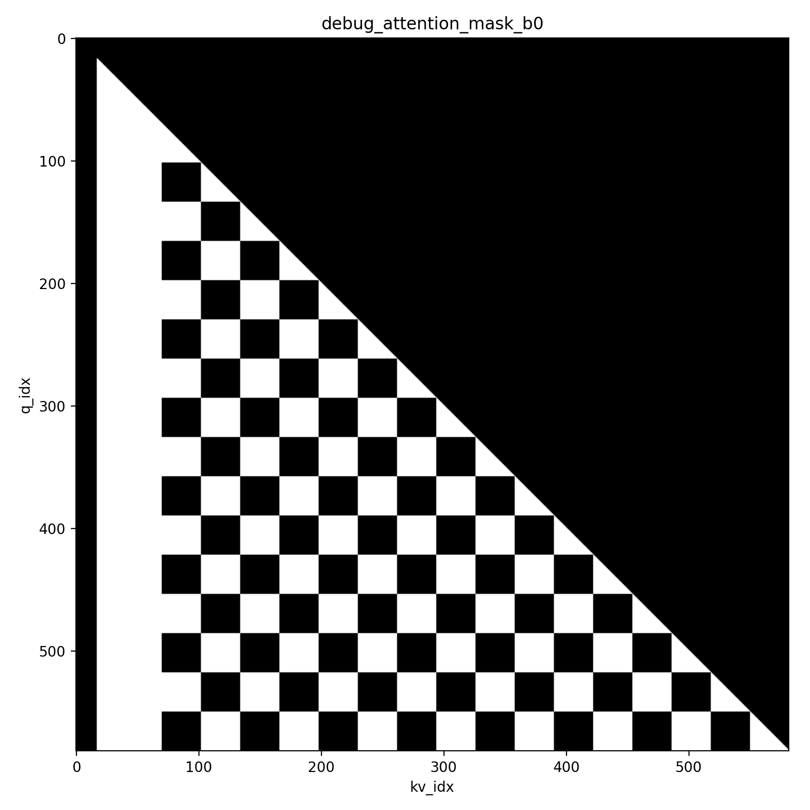
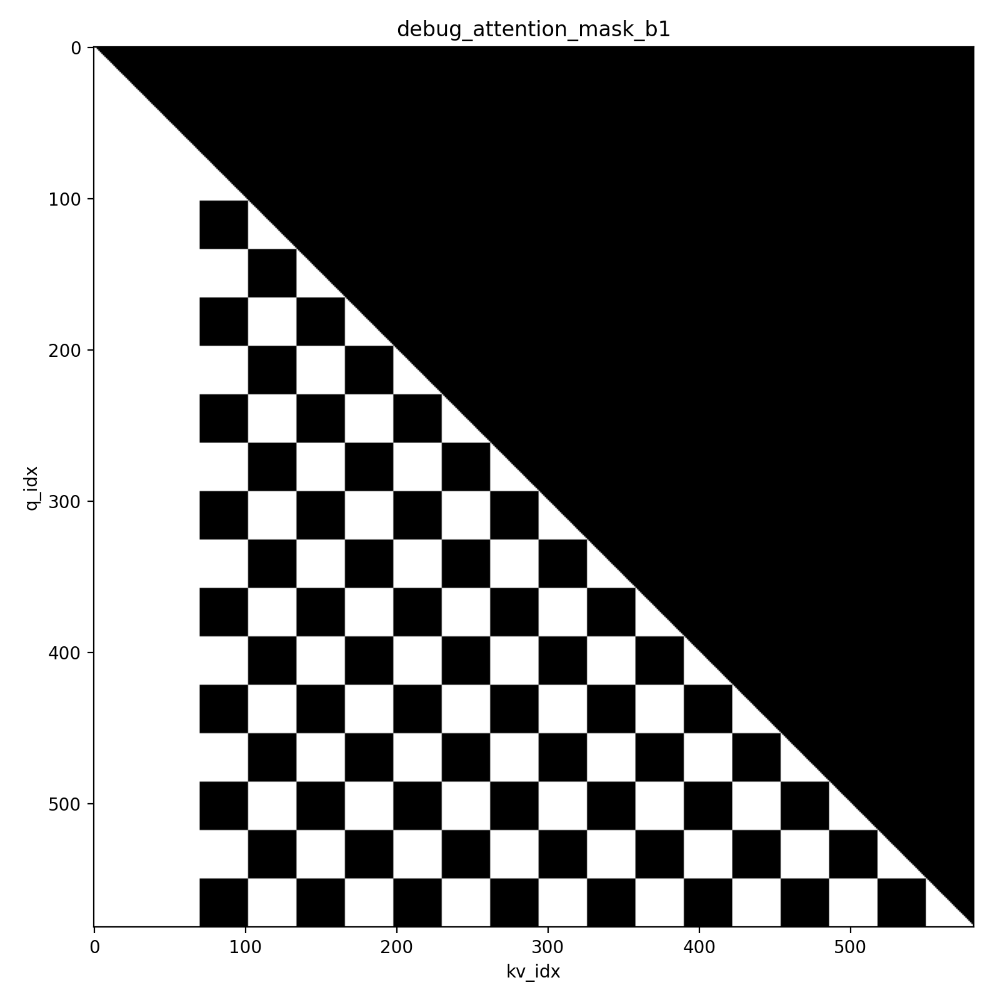

# Jacobi4OneRec

A port of [Jacobi Forcing](https://github.com/hao-ai-lab/JacobiForcing) ([paper](https://arxiv.org/abs/2512.14681)) to **OneRec-1.7B** ([OpenOneRec](https://github.com/Kuaishou-OneRec/OpenOneRec), Qwen3 architecture).

Jacobi Forcing fine-tunes an AR model on its own Jacobi decoding trajectories. The model learns to map noisy future blocks to their fixed points, so it can decode several tokens per forward pass while still decoding causally, left to right, with a KV cache.

## Changes from upstream

The `init` commit (`6ab9d71`) imports `inference_engine/` from an upstream snapshot taken on 2026-03-18. Upstream's training, data and eval code is not included; the pipeline is rewritten as numbered scripts at the repo root.

| Stage | Upstream | This repo |
| --- | --- | --- |
| Model | Qwen2.5-Coder/Math-7B through a copied, modified Qwen2 modeling file | Any HF Qwen3 model. `patch.py` binds `forward_jacobi` onto the HF model instance |
| Trajectory collection | `generate_trajectory/generation/*`, JSONL, one record per `(data_id, itr)` | `01_generate.py`: batched (left padding, per-sample acceptance), temperature/top-k/top-p, Parquet with one row per sample holding every block's full trajectory |
| Noise packing | `2_prepare_efficient_cllm_training_data_progressive_noise_window.py` (JSONL + SQLite) | `02_window.py`: Parquet in/out, noise level picked by block index `j % window_size`, new `--block_slide_step` sliding-window augmentation |
| Training | Custom `training_step`, `batch_size=1` only, hard-coded loss weights | `03_train.py`: standard HF `Trainer` (only `compute_loss` overridden), batched collator, compiled FlexAttention block mask, configurable loss weights, LoRA, DeepSpeed ZeRO-2 |
| Inference | `inference_engine/` (nano-vLLM) + eval scripts | `inference_engine/` kept, with bug fixes (below). Entry points: `04_infer.py` (HF + patch) and `04_infer_engine.py` |
| Extras | — | `00_convert.py` (convert upstream HF training data), `00_fix_parquet.py` (recover a Parquet file with no footer), Modal launchers, `tools/` inspection scripts |

**Training differences.** The sequence layout and attention semantics match upstream's multiblock trainer: noisy blocks attend to previous noisy blocks, and clean blocks attend to previous clean blocks. The losses differ:
- AR loss uses only the clean blocks (no prompt tokens), with optional label smoothing.
- Consistency loss covers every noisy token. Upstream starts it at the first position where the noisy and clean blocks diverge. An optional per-position weight `linspace(consistency_scale → 1)` can be applied.

**`inference_engine/` fixes** (`git diff 6ab9d71 -- inference_engine`):
- Renamed the config field `jacobi_max_blocks` to `jacobi_max_block_len`. `model_runner` reads `jacobi_max_block_len`, so the old name was silently ignored.
- Added `top_k`/`top_p` to `SamplingParams`.
- Freed the KV blocks of finished on-policy sequences. They used to leak.
- An empty schedule now returns instead of hitting an `assert`.
- Free blocks are checked against the whole draft allocation.
- `rope_scaling` is no longer passed to `get_rope`.

**Removed:** `applications/`, `JacobiForcing/`, `generate_trajectory/`, `assets/`. The upstream Apache-2.0 `LICENSE` is kept.

## Layout

```
00_convert.py          upstream HF training data -> this repo's format (optional)
00_fix_parquet.py      rebuild a valid Parquet file from an interrupted writer
01_generate.py         step 1: collect Jacobi trajectories with the base model
02_window.py / .sh     step 2: progressive noise schedule + sequence packing
03_train.py            step 3: Jacobi Forcing training
04_infer.py            step 4: Jacobi decoding with HF + patch (prints tokens/forward)
04_infer_engine.py     step 4: Jacobi decoding with inference_engine
patch.py               forward_jacobi: batched Jacobi forward + KV cache helpers
modal_app.py, *_modal.py   Modal image and launchers
configs/ds_config.json DeepSpeed ZeRO-2
inference_engine/      upstream nano-vLLM Jacobi engine (patched)
tools/                 data inspection scripts (# %% cells)
docs/images/           figures
outputs/               (gitignored) models, data, checkpoints, logs
```

## Setup

```bash
uv venv --python 3.12 .venv && source .venv/bin/activate
uv pip install -r requirements.txt
uv pip install <flash-attn wheel matching your CUDA/torch>   # e.g. flash_attn-2.8.3+cu128torch2.10
```

Developed with torch 2.10, transformers 5.3, and flash-attn 2.8.3. `patch.py` relies on recent `transformers` APIs (`DynamicLayer`, `masking_utils`). Run every script from the repo root.

## Pipeline

```bash
# 1. Collect trajectories. Input is SFT Parquet with messages/uuid/source; the last message is dropped.
python 01_generate.py --model outputs/OneRec-1.7B --dataset data.parquet -o outputs/trajectory/part.parquet \
    --n_token_seq_len 32 --max_new_seq_len 1024 --batch_size 64 --temperature 0.75 --top_k 20 --top_p 0.95

# 2. Pack with the noise schedule. Output goes to outputs/trajectory_n{N}w{W}s{S}/ (override with env vars).
WINDOW_SIZE=16 BLOCK_SLIDE_STEP=1 MIN_NOISY_RATIO=0.5 bash 02_window.sh outputs/trajectory

# (alternative to 1+2) convert upstream released data
python 00_convert.py "<hf_data>/*.parquet" -o outputs/datasets/converted.parquet \
    --model outputs/OneRec-1.7B --n_token_seq_len 64 --trim_system_prompt --add_think_token

# 3. Train
torchrun --nproc-per-node=2 03_train.py --model_path outputs/OneRec-1.7B \
    --data_path "outputs/trajectory_n32w16s1/*.parquet" --output_dir outputs/OneRec-1.7B-n32w16 \
    --max_blocks 32 --per_device_train_batch_size 2 --ar_loss_weight 10 --label_smoothing_factor 0.1 \
    --bf16 --do_train --learning_rate 1e-5 --lr_scheduler_type cosine --warmup_ratio 0.03 \
    --deepspeed configs/ds_config.json --report_to wandb

# 4. Inference
python 04_infer.py --model outputs/OneRec-1.7B-n32w16 --dataset eval.parquet   # add --lora <dir> for adapters
python 04_infer_engine.py --model outputs/OneRec-1.7B-n32w16 --dataset eval.parquet
```

On Modal (requires a `wandb` secret and an `onerec` volume mounted at `/mnt`): `modal run 01_generate_modal.py` / `modal run 03_train_modal.py`. Edit the paths and hyperparameters inside the scripts.

### Data formats

- **Trajectories** (step 1): `uuid`, `source`, `prompt_ids`, `blocks[block][iteration][token]`. `blocks[j][-1]` is the fixed point.
- **Training data** (step 2 / `00_convert.py`): `prompt_ids`, `blocks[block][token]` (noisy), `answers[block][token]` (fixed points). Every block has length `n`.

## Training details

Each sample is packed as `[PAD][PROMPT][B1][A1][B2][A2]…`. `B_j` is a noisy block and `A_j` is its fixed point; each `(B_j, A_j)` pair shares the same position ids. The attention mask is

```python
causal & (kv >= n_pad) & ((kv < n_prompt) | (q_block % 2 == kv_block % 2))
```

so noisy blocks see the prompt and earlier noisy blocks, and clean blocks see the prompt and earlier clean blocks. These are the masks of two samples from one batch (white = visible; `b0` has left padding):

| b0 | b1 |
| --- | --- |
|  |  |

Loss = `ar_loss_weight · CE(clean next-token)` + `T²/n · softCE(noisy logits / T, softmax(clean logits.detach() / T))`.

## Citation

```bibtex
@misc{hu2025fastaccuratecausalparallel,
  title={Fast and Accurate Causal Parallel Decoding using Jacobi Forcing},
  author={Lanxiang Hu and Siqi Kou and Yichao Fu and Samyam Rajbhandari and Tajana Rosing and Yuxiong He and Zhijie Deng and Hao Zhang},
  year={2025}, eprint={2512.14681}, archivePrefix={arXiv}, primaryClass={cs.CL}
}
```

`inference_engine/` is derived from [hao-ai-lab/JacobiForcing](https://github.com/hao-ai-lab/JacobiForcing) (Apache-2.0), which builds on [nano-vLLM](https://github.com/GeeeekExplorer/nano-vllm).
